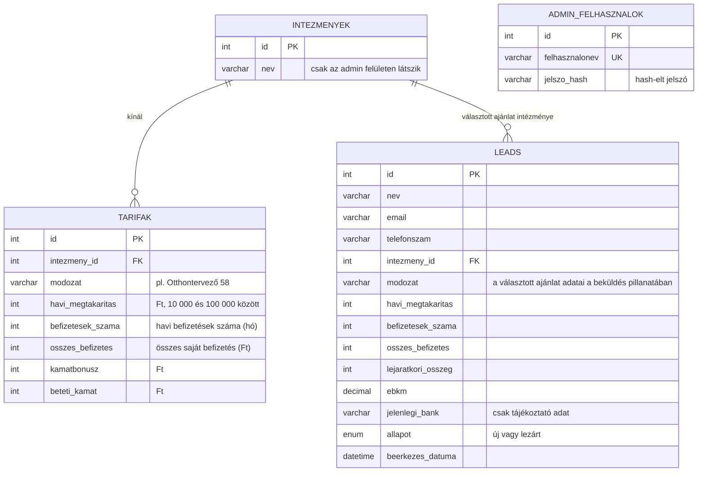

# Entity Relationship Diagram

A diagram a kamatbonusz.hu által tárolt összes adatot és azok kapcsolatait mutatja be.

## Kapcsolatok

| Kapcsolat | Típus | Jelentés |
|---|---|---|
| intezmenyek → tarifak | 1 : N | Egy intézménynek több tarifasora lehet, egy tarifasor pontosan egy intézményhez tartozik. |
| intezmenyek → leads | 1 : N | Egy intézményt több érdeklődő is választhat, egy érdeklődés pontosan egy intézmény ajánlatára vonatkozik. |
| admin_felhasznalok | önálló | Az admin felhasználók tábla nem kapcsolódik a többihez, csak a bejelentkezéshez kell. |

## Számított értékek

Két értéket nem tárolunk a `tarifak` táblában, mert a többi adatból kiszámolhatók:

- **Lejáratkor felvehető összeg** = összes saját befizetés + kamatbónusz + betéti kamat
- **EBKM** = a havi befizetésekből és a lejáratkor felvehető összegből számított éves hozam

A `leads` tábla ezzel szemben elmenti a választott ajánlat összes adatát, mert a tarifák később változhatnak, a megrendelőnek pedig azt kell látnia, amit az érdeklődő a beküldéskor választott.

**Jelmagyarázat:** PK (elsődleges kulcs) az egyedi azonosító. FK (idegen kulcs) egy másik tábla azonosítójára mutat. UK (egyedi kulcs) nem ismétlődhet.
