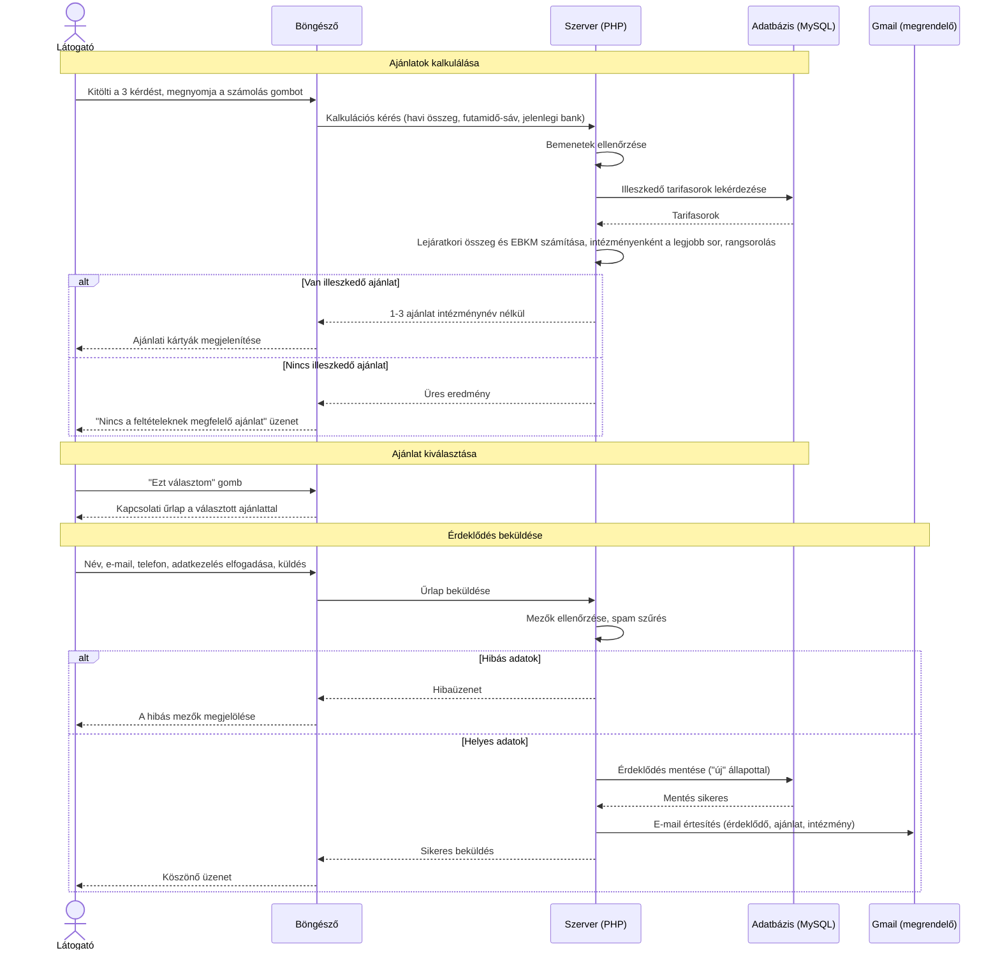

# Sequence diagram

A diagram az "Ajánlatok kalkulálása", az "Ajánlat kiválasztása" és az "Érdeklődés beküldése" használati esetek lépéseit mutatja be időrendben, a kamatbonusz.hu szereplői közötti üzenetekkel.

**Jelmagyarázat:** a függőleges szaggatott vonalak a szereplők életvonalai, fentről lefelé telik az idő. A folytonos nyíl egy kérés, a szaggatott nyíl a rá adott válasz. Az "alt" blokk két lehetséges kimenetet mutat, amelyek közül mindig csak az egyik történik meg.
