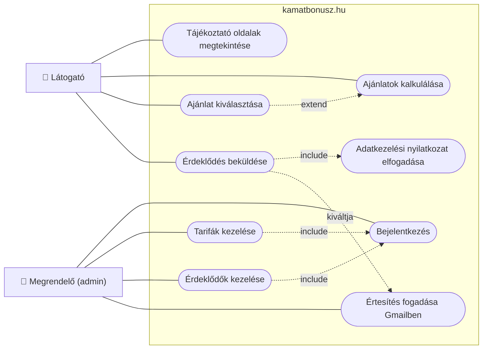

# Use Case diagram

A diagram a kamatbonusz.hu funkcióit mutatja be a felhasználók szemszögéből, a rendszer belső működése nélkül.

## Használati esetek és kiváltó eseményeik

| Szereplő | Használati eset | Kiváltó esemény |
|---|---|---|
| Látogató | Tájékoztató oldalak megtekintése | A látogató rákattint egy menüpontra (Kezdőlap, Ismertető, Garanciák). |
| Látogató | Ajánlatok kalkulálása | A látogató megválaszolja a 3 kérdést, és megnyomja a számolás gombot. |
| Látogató | Ajánlat kiválasztása | A látogató egy ajánlati kártyán az "Ezt választom" gombra kattint. |
| Látogató | Érdeklődés beküldése | A látogató kitölti a kapcsolati űrlapot, és megnyomja a küldés gombot. |
| Látogató | Adatkezelési nyilatkozat elfogadása | A látogató bejelöli az adatkezelési jelölőnégyzetet az űrlapon. |
| Megrendelő | Bejelentkezés | A megrendelő megnyitja az admin oldalt, és megadja a felhasználónevét és jelszavát. |
| Megrendelő | Tarifák kezelése | A megrendelő új tarifát rögzít, vagy egy meglévőt módosít, illetve töröl. |
| Megrendelő | Érdeklődők kezelése | A megrendelő megnyitja az érdeklődők listáját, állapotot vált vagy töröl. |
| Megrendelő | Értesítés fogadása Gmailben | Egy látogató érdeklődést küld be, és a megrendelő e-mailt kap a Gmail fiókjába. |

**Jelmagyarázat:** a folytonos vonal azt jelzi, melyik szereplő használja az adott funkciót. Az "include" azt jelenti, hogy az egyik funkció mindig magában foglalja a másikat (például tarifát csak bejelentkezés után lehet kezelni). Az "extend" azt jelenti, hogy egy funkció egy másikat bővít ki, de nem mindig kötelező.
